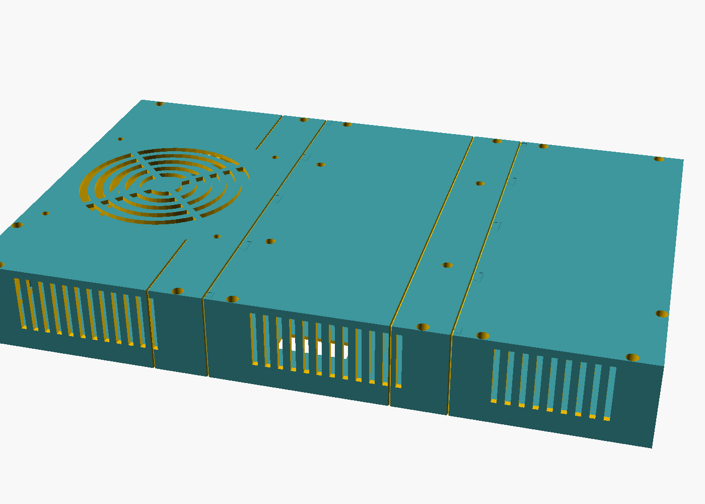
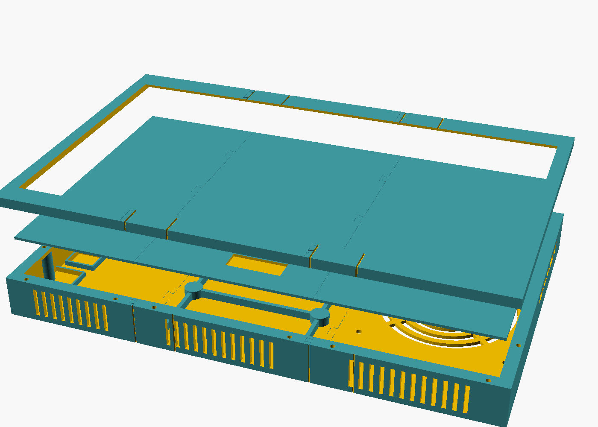
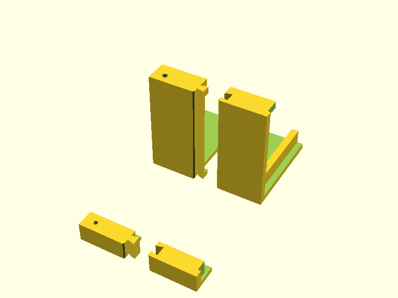

# x1case

A 3D-printable all-in-one case for a **Lenovo ThinkPad X1 Extreme Gen 1** (machine type 20MF, same chassis as the P1 Gen 1; panel AUO B156ZAN03.2, active area 344 × 193 mm). The original display lid (4K touch panel, bezel and back cover) stays intact; only the laptop base is removed. A printed clamp wraps the lid, and the mainboard sits behind it. The back shell carries a 120 mm assist fan controlled by an ESP32 and a VESA 100 mount. The keyboard is removed and replaced by a wireless one. The machine runs on AC only, with no battery.

The split-and-glue approach follows [yggdrion/wooting-waveshare](https://github.com/yggdrion/wooting-waveshare): parametric OpenSCAD, dovetailed pieces glued together, and seams hidden in V-grooves.

> **Status: skeleton.** Every dimension marked `PLACEHOLDER` in `x1case.scad` is a guess. Nothing has been printed or test-fitted yet.

## Layout (front to back)

| Layer | Part | Notes |
|---|---|---|
| Front clamp ring | `frame_*` | 3 pieces, printed front face down. A 3 mm lip over the lid's front edge, a 4.5 mm wall (7.5 mm at the bottom, with the cable channel) and pilot holes for the shell screws |
| Display lid | — | Original, untouched apart from the removed hinges |
| Board tray | `tray_*` | 3 pieces. Rests on the lid back, screwed into the old hinge holes. Carries the board standoffs (M2 inserts) |
| Air gap, board + stock heatsink/blowers | — | Board top side faces the lid, heatsink side faces the back |
| Back shell | `shell_*` | 3 pieces, printed back face down. 120 mm fan grille, VESA 100 bosses with M4 inserts, ESP32 + 2× buck cradles, DC jack, top/bottom vents. No board port cutouts: only DC-in is used, through an internal cable |

The shell's front rim presses on the lid's back edge, so the lid is clamped between the rim and the frame lip around its full outline. Shell screws (M2 × 12 self-tapping, plastite style) go in from the back through counterbored bosses into pilot holes in the frame wall. The cable bundle leaves the lid's bottom edge at the old hinge gap, runs through a channel in the bottom wall and enters the shell through a gap in the rim.

## Split

Seams sit at `seams = [136, 268]`, giving pieces of about 136 / 132 / 103 × 249 mm on a 256 mm bed. The height is tight: the clamp walls are thin so a ~236 mm lid still fits. The left piece holds the fan, the middle piece holds the VESA pad, and the right piece holds the electronics bay. Mirrored fake grooves keep the pattern symmetric. The dovetails slide together along Z (front to back), and the glue line sits in a groove. The file prints a `WARNING` echo when a piece does not fit the bed or a seam cuts through the fan, VESA pad or cable channel.

`frame_m` exports as two separate strips (top and bottom), because the window spans the full middle piece. Glue both strips to the end pieces in one go, so the dovetails keep them aligned.




## Cooling and power

- The stock heatpipe and blowers stay. The 120 mm × 25 mm fan (`fan_t = 15` for a slim NF-A12x15) pulls air from the bottom vents across the board and out the back. The top vents act as a chimney.
- The charger plugs into a DC jack on the right wall. It feeds the board's DC-in, a 12 V buck for the fan and a 5 V buck for the ESP32.
- The ESP32-C3 SuperMini runs standalone. DS18B20 sensors on the heatsink, VRM area and exhaust set a firmware fan curve: 25 kHz PWM, tach read back, 100 % if a sensor fails. Its USB-C port is reachable through the right wall.

## Machine setup

- BIOS → Config → Power → **Power On with AC Attach**, because the power button goes away with the keyboard.
- Check for battery-less throttling (BD PROCHOT) under load. If needed, clear bit 0 of MSR `0x1FC` at boot.

## Still to measure

See [docs/measure.png](docs/measure.png) (numbered drawing) and [docs/measurements.md](docs/measurements.md) (fill-in list).

1. Lid outline, corner radius, thickness (thickest point and at the edge) and bezel widths (`lid_*`, `bezel`), old hinge holes and their thread (`lid_anchors`), hinge stubs, and cable exit (`cable_exit`)
2. Board outline, mounting holes, heatsink footprint and height, tallest parts (`board_*`, `heatsink_*`, `comp_h`)
3. eDP cable length, which limits how far `board_pos` can sit from the cable exit
4. DC-in position and plug length (`dc_in_*`, `dc_plug_len`). The render warns when the plug doesn't fit between the board and the side wall

## Test prints

Small slices of the real parts, to check fit before printing full pieces:

- `test_corner`: bottom-left frame corner (70 × 50 mm). Lay the lid corner in: check the fit gap, corner radius, lip over the bezel, and that the lid back sits flush with the frame back. Print after the lid is measured.
- `test_seam`: frame + shell halves around the left seam, bottom wall. Check dovetail slide fit, the V-groove, and that an M2 × 12 plastite screw bites in the pilot hole. Independent of the measurements, so it can print now.

Tune `fit`, `tol` and `screw_pilot_d` from the results.



## Render

Requires OpenSCAD 2021.01+.

```bash
openscad -o stl/shell_m.stl -D 'part="shell_m"' x1case.scad
```

Parts: `frame_l|m|r`, `tray_l|m|r`, `shell_l|m|r`, `test_corner`, `test_seam`, plus `assembly` (with `explode` and `show_ghosts`).
