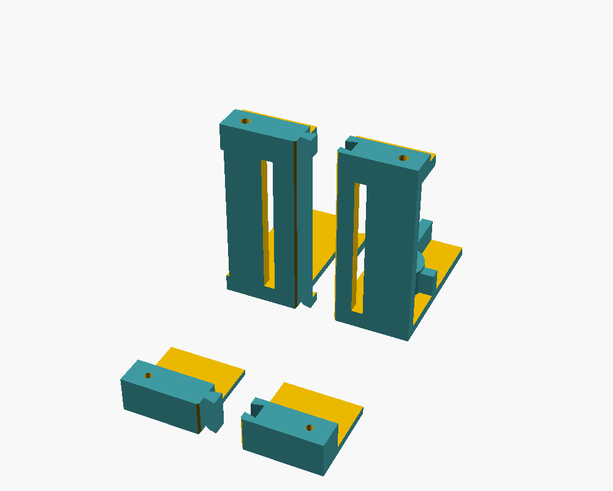

# x1case

A 3D-printable all-in-one case for a **Lenovo ThinkPad X1 Extreme Gen 1** (machine type 20MF, same chassis as the P1 Gen 1; panel AUO B156ZAN03.2, active area 344 × 193 mm). The original display lid (4K touch panel, bezel and back cover) stays intact; only the laptop base is removed. A printed clamp wraps the lid, and the mainboard sits behind it. The back shell carries two 120 mm assist fans controlled by an ESP32 and a VESA 100 mount. The keyboard is removed and replaced by a wireless one. The machine runs on AC only, with no battery.

The split-and-glue approach follows [yggdrion/wooting-waveshare](https://github.com/yggdrion/wooting-waveshare): parametric OpenSCAD, dovetailed pieces glued together, and seams hidden in V-grooves.

> **Status: skeleton.** Every dimension marked `PLACEHOLDER` in `x1case.scad` is a guess. Nothing has been printed or test-fitted yet.

## Layout (front to back)

| Layer | Part | Notes |
|---|---|---|
| Front clamp ring | `frame_*` | 6 pieces, printed front face down. A 3 mm lip over the lid's front edge, a 4.5 mm wall (7.5 mm at the bottom, with the cable channel) and pilot holes for the shell screws |
| Display lid | — | Original. The hinge stubs stay on and stick out 12 mm past the glass; a 14 mm bottom lip covers the open strip along the hinge edge |
| Stub hoods | `hood` | Print 2. Small caps glued on the front of the bottom lip over the stubs, which poke through holes in the lip |
| Board tray | `tray_*` | 6 pieces. Covers the lid back up to its edge; the shell rim clamps its edge onto the lid (no screws). Carries the board standoffs (M2 inserts) |
| Air gap, board + stock heatsink/blowers | — | Board top side faces the lid, heatsink side faces the back |
| Back shell | `shell_*` | 6 pieces, printed back face down. Two 120 mm fan grilles, VESA 100 bosses with M4 inserts, ESP32 + 2× buck cradles, a window for the stock DC-in jack in the back plate, top/bottom vents. No board port cutouts: only DC-in is used |

The shell's front rim presses on the lid's back edge, so the lid is clamped between the rim and the frame lip around its full outline. Shell screws (M2 × 12 self-tapping, plastite style) go in from the back through counterbored bosses into pilot holes in the frame wall. The cable bundle leaves the lid's bottom edge at the old hinge gap, runs through a channel in the bottom wall and enters the shell through a gap in the rim.

## Split

Vertical seams sit at `seams = [61.5, 309]` (columns of about 62 / 248 / 62 mm), just outside the two fans and symmetric. The case is taller than the 256 mm bed, so a horizontal seam at `hseam = 137` splits each column into a bottom (`b`, 137 mm) and a top (`t`) piece: 6 pieces per part. The horizontal seam runs between the fans and the VESA pad. The middle column holds both fans (bottom) and the VESA pad (top), and the right column holds the electronics bay. The dovetails slide together along Z (front to back), and the glue line sits in a groove. The file prints a `WARNING` echo when a piece does not fit the bed or a seam cuts through the fan, VESA pad, cable channel, the DC jack window or a cradle.

`frame_mb` and `frame_mt` are the bottom and top strips of the middle frame, because the window spans the full middle column. Glue each column's bottom and top piece first, then the columns together, so the dovetails keep everything aligned.


## Cooling and power

- The stock cooler stays: one blower at each end of the board, heatpipes between, fin stacks on the board's top edge. The fin stacks blow up into the top vents.
- The board sits low (`board_bottom_gap`), close to the lid's cable exits. Two 120 mm × 25 mm fans (`fan_t = 15` for slim NF-A12x15s) sit side by side in the centre, low down over the heatpipe (`fan_y`). They pull air in through the back grilles and push it onto the heatpipe and the blower intakes. The depth budget stacks the fans on the heatsink.
- The stock DC-in jack sits on a short cable next to the right fin stack. It points out through an oversized window in the back plate and is hot-glued in place, so the original charger plugs in from behind; the brick stays outside the case because of its heat. Tap its two wires for the 12 V buck (fan) and the 5 V buck (ESP32).
- The ESP32-C3 SuperMini runs standalone. DS18B20 sensors on the heatsink, VRM area and exhaust set a firmware fan curve: 25 kHz PWM, tach read back, 100 % if a sensor fails. Its USB-C port is reachable through the right wall.

## Machine setup

- BIOS → Config → Power → **Power On with AC Attach**, because the power button goes away with the keyboard.
- Check for battery-less throttling (BD PROCHOT) under load. If needed, clear bit 0 of MSR `0x1FC` at boot.

## Still to measure

See [docs/measure.png](docs/measure.png) (numbered drawing) and [docs/measurements.md](docs/measurements.md) (fill-in list).

1. Lid outline, corner radius, thickness (thickest point and at the edge) and bezel widths (`lid_*`, `bezel`), old hinge holes and their thread (`lid_anchors`), hinge stubs, and cable exit (`cable_exit`)
2. Board outline, mounting holes, blower intakes and fin-stack exhausts, heatsink height, tallest parts (`board_*`, `blowers`, `fin_exhausts`, `heatsink_h`, `comp_h`)
3. eDP cable length, which limits how far `board_pos` can sit from the cable exit
4. Nothing for the DC-in jack: it is hot-glued in an oversized back-plate window (`dc_window`)

## Test prints

Small slices of the real parts, to check fit before printing full pieces:

- `test_corner`: bottom-left frame corner (70 × 50 mm). Lay the lid corner in: check the fit gap, corner radius, lip over the bezel, and that the lid back sits flush with the frame back. Print after the lid is measured.
- `test_seam`: frame + shell halves around the left seam, bottom wall. Check dovetail slide fit, the V-groove, and that an M2 × 12 plastite screw bites in the pilot hole. Independent of the measurements, so it can print now.

- `test_holes_l` + `test_holes_r`: 1.2 mm skeleton of the board outline with an M2 pin at every mounting hole, split in two for the bed. Butt the halves together on a flat table and lay the board on top: every hole should drop over a pin.

Tune `fit`, `tol` and `screw_pilot_d` from the results. Move a `board_holes` entry when its pin misses.



## Render

Requires OpenSCAD 2021.01+.

```bash
openscad -o stl/shell_mt.stl -D 'part="shell_mt"' x1case.scad
```

Parts: `frame|tray|shell` + `_` + column `l|m|r` + row `b|t` (e.g. `shell_lb`), `hood`, `test_corner`, `test_seam`, `test_holes_l`, `test_holes_r`, plus `assembly` (with `explode` and `show_ghosts`).
