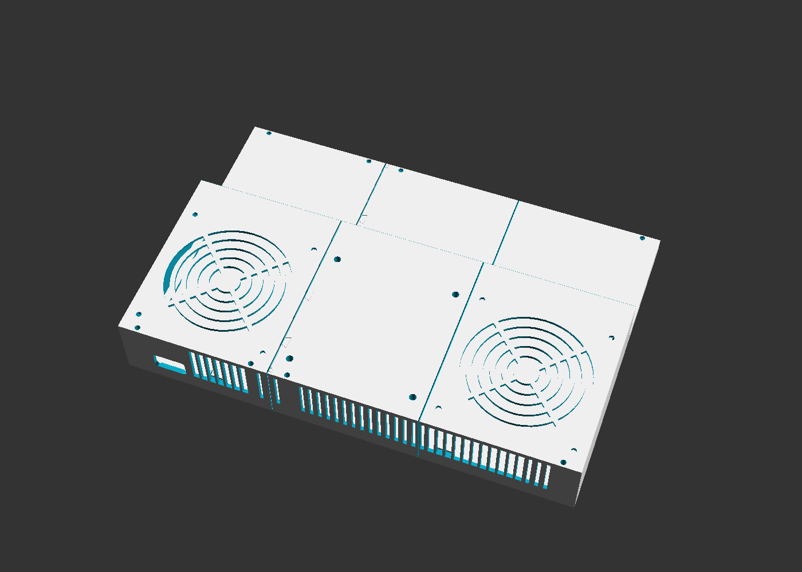
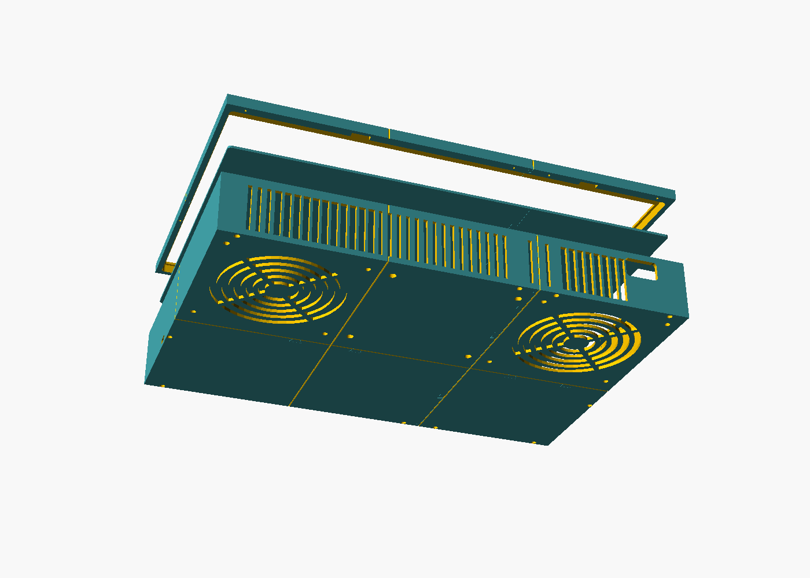

# x1case

A 3D-printable all-in-one case for a **Lenovo ThinkPad X1 Extreme Gen 1** (machine type 20MF, same chassis as the P1 Gen 1; panel AUO B156ZAN03.2, active area 344 × 193 mm). The original display lid (4K touch panel, bezel and back cover) stays intact; only the laptop base is removed. A printed clamp wraps the lid, and the mainboard sits behind it. The back shell carries two 120 mm assist fans controlled by an ESP32, with a VESA 100 mount between them. The keyboard is removed and replaced by a wireless one. The machine runs on AC only, with no battery.

The split-and-glue approach follows [yggdrion/wooting-waveshare](https://github.com/yggdrion/wooting-waveshare): parametric OpenSCAD, dovetailed pieces glued together, and seams hidden in V-grooves.

> **Status: skeleton.** Every dimension marked `PLACEHOLDER` in `x1case.scad` is a guess. Nothing has been printed or test-fitted yet.

## Layout (front to back)

| Layer | Part | Notes |
|---|---|---|
| Front clamp ring | `frame_*` | 4 pieces, printed front face down. A 3 mm lip over the lid's front edge, a 4.5 mm wall (7.5 mm at the bottom, with the cable channel) and pilot holes for the shell screws |
| Display lid | — | Original. The hinge stubs stay on and stick out 12 mm past the glass; a 14 mm bottom lip covers the open strip along the hinge edge, with an open hole for each stub (cut the stubs off later) |
| Board tray | `tray_*` | 4 pieces. Covers the lid back up to its edge; the shell rim clamps its edge onto the lid (no screws). Flat: M2 × 5 mm brass standoffs (female-female) screw onto the board and get glued to the tray, so no hole positions need measuring |
| Air gap, board + stock heatsink/blowers | — | Board top side faces the lid, heatsink side faces the back |
| Back shell | `shell_*` | 4 pieces, printed back face down. Two 120 mm fan grilles, VESA 100 bosses with M4 inserts, ESP32 + 2× buck cradles, a window for the stock DC-in jack in the bottom wall, top/bottom vents (wider at the fin-stack exhausts). No board port cutouts: only DC-in is used |

The shell's front rim presses on the lid's back edge, so the lid is clamped between the rim and the frame lip around its full outline. Shell screws (M2 × 12 self-tapping, plastite style) go in from the back through counterbored bosses into pilot holes in the frame wall. The cable bundle leaves the lid's bottom edge at the old hinge gap, runs through a channel in the bottom wall and enters the shell through a gap in the rim.

## Split

One vertical seam sits at `seams = [125.65]` (columns of about 126 / 245 mm), in the 5 mm gap between the left fan and the VESA pad; a mirrored fake groove on the right keeps it symmetric. The case is taller than the 256 mm bed, so a horizontal seam at `hseam = 137` splits each column into a bottom (`b`, 137 mm) and a top (`t`) piece: 4 pieces per part. The bottom row holds fan, VESA pad, fan side by side, so the mount sits in the same row as the heavy parts and only the light top row hangs on the horizontal seam. The electronics bay sits top right. The dovetails slide together along Z (front to back), and the glue line sits in a groove. The file prints a `WARNING` echo when a piece does not fit the bed or a seam cuts through the fan, VESA pad, cable channel, the DC jack window or a cradle.

Glue each column's bottom and top piece first, then the columns together, so the dovetails keep everything aligned.




## Cooling and power

- The stock cooler stays: one blower at each end of the board, heatpipes between, fin stacks on one long edge. The board is turned 180° (`board_flip`) so the fin edge faces down, next to the lid's cable exits: shortest cable run to the display. The fin stacks blow down, about 9 mm, straight into wider bottom vents (`vent_w_fin`).
- The board sits low (`board_bottom_gap`), close to the lid's cable exits. Two 120 mm × 25 mm fans (`fan_t = 15` for slim NF-A12x15s) sit against the side walls, low down (`fan_y`), each right over a blower intake. They pull air in through the back grilles and push fresh air into the blowers and over the board. The depth budget stacks the fans on the heatsink.
- The stock DC-in jack sits on a short cable next to a fin stack, so with the board flipped it ends up at the bottom edge. It points down through an oversized window in the bottom wall (`dc_cut`) and is hot-glued in place, so the original charger plugs in from below; the brick stays outside the case because of its heat. Tap its two wires for the 12 V buck (fan) and the 5 V buck (ESP32).
- The ESP32-C3 SuperMini runs standalone. DS18B20 sensors on the heatsink, VRM area and exhaust set a firmware fan curve: 25 kHz PWM, tach read back, 100 % if a sensor fails. Its USB-C port is reachable through the right wall.

## Machine setup

- BIOS → Config → Power → **Power On with AC Attach**, because the power button goes away with the keyboard.
- Check for battery-less throttling (BD PROCHOT) under load. If needed, clear bit 0 of MSR `0x1FC` at boot.

## Still to measure

See [docs/measure.png](docs/measure.png) (numbered drawing) and [docs/measurements.md](docs/measurements.md) (fill-in list).

1. Lid outline, corner radius, thickness (thickest point and at the edge) and bezel widths (`lid_*`, `bezel`), old hinge holes and their thread (`lid_anchors`), hinge stubs, and cable exit (`cable_exit`)
2. Board outline, mounting holes, blower intakes and fin-stack exhausts, heatsink height, tallest parts (`board_*`, `blowers`, `fin_exhausts`, `heatsink_h`, `comp_h`)
3. eDP cable length, which limits how far `board_pos` can sit from the cable exit
4. Nothing for the DC-in jack: it is hot-glued in an oversized bottom-wall window (`dc_cut`)

## Test prints

Small slices of the real parts, to check fit before printing full pieces:

- `test_corner`: bottom-left frame corner (70 × 50 mm). Lay the lid corner in: check the fit gap, corner radius, lip over the bezel, and that the lid back sits flush with the frame back. Print after the lid is measured.
- `test_seam`: frame + shell halves around the left seam, bottom wall. Check dovetail slide fit, the V-groove, and that an M2 × 12 plastite screw bites in the pilot hole. Independent of the measurements, so it can print now.

Tune `fit`, `tol` and `screw_pilot_d` from the results.


## Render

Requires OpenSCAD 2021.01+.

```bash
openscad -o stl/shell_rb.stl -D 'part="shell_rb"' x1case.scad
```

Parts: `frame|tray|shell` + `_` + column `l|r` + row `b|t` (e.g. `shell_lb`), `test_corner`, `test_seam`, plus `assembly` (with `explode` and `show_ghosts`).
