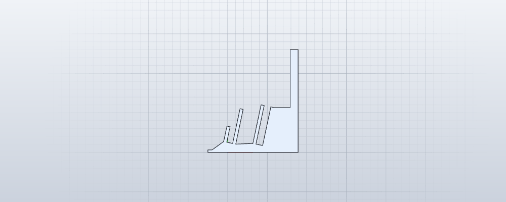

# interim_stand_shoe

One-piece interim stand for the bare lid and board: two shoes joined by a vertical VESA 100 plate, so an arm carries the whole assembly. The model is plain coordinates, not parametric, and is not tied to `x1case.scad`.

| File | What |
|---|---|
| `stand_shoe.stl` | the part, ready to print |
| `solidcraft.json` | SolidCraft batch that rebuilds it (`batch` with `path`) |
| `profile.png`, `preview.png` | side profile and iso view |

## Design

- Two shoes, 30 mm each, 80 mm gap, 140 mm outside. Each has a lid slot and a board slot, both leaning back 12° (slot 7.6 mm, 21 mm channel, board slot 8.6 mm, 4 mm walls, 50 mm board walls).
- A vertical plate joins the shoes: 10 mm thick, 130 mm tall, 140 mm wide, x = 79..89 mm. An arm's VESA plate sits flat on the back face at x = 89. The plate is behind the leaning board, so it clears the 10 mm heatsink by 5.6 mm at the top.
- A solid web fills the space between each board rear wall and the plate, up to y = 56.7 mm. There is no base tail: the arm carries the weight.
- VESA 100: four M4 heat-set inserts at y = 20 / 120 and z = 20 / 120, pressed in from the back face (hole d 5.7, 8.5 deep, 1.5 mm of plate stays in front).
- Size 114 x 130 x 140 mm, volume 353 185 mm³, one body.
- Print standing on the base, no supports. PETG-HF, 5 walls, 40 % gyroid or less (the web is solid), 0.2 mm layers.
- Strength is a hand estimate: 5 kg design load about 70 mm in front of the plate gives about 3.4 N·m. Inserts see about 17 N pull and 12 N shear each, the plate section above the web about 1 MPa across layers. Not checked by FEA or a print.
