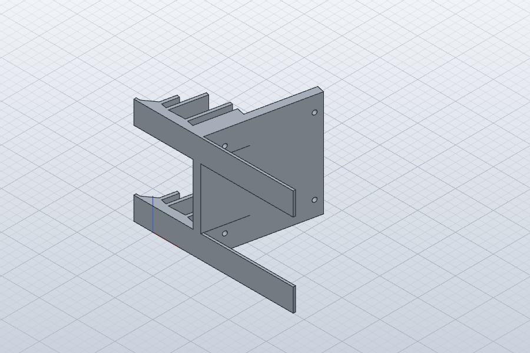
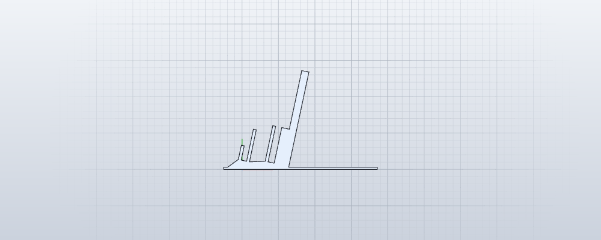
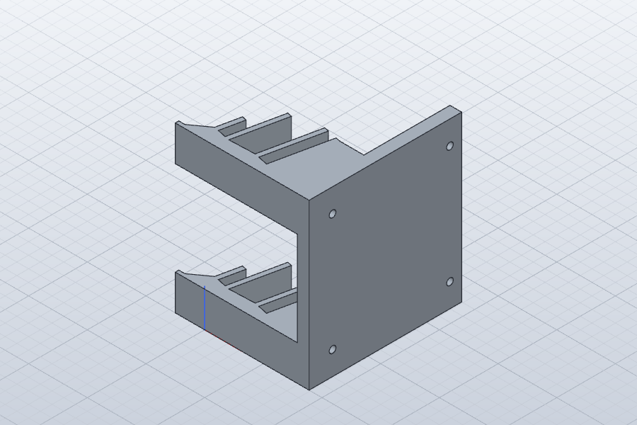

# interim_stand_shoe

Interim stand shoe: a 2D profile (XY) extruded 30 mm in Z. Both slots lean back 12°.
The profile is plain coordinates, not parametric. The model is not tied to `x1case.scad`.

| File | What |
|---|---|
| `stand_shoe_v1.stl` | original shoe |
| `stand_shoe_v2.stl` | reworked shoe |
| `solidcraft_v2.json` | SolidCraft batch that rebuilds v2 (`batch` with `path`) |
| `profile_v2.png` | profile view of v2 |
| `stand_shoe_v3.stl` | one-piece stand: both shoes plus a VESA 100 plate |
| `solidcraft_v3.json` | SolidCraft batch that rebuilds v3 (`batch` with `path`) |
| `profile_v3.png`, `preview_v3.png` | profile and iso view of v3 |
| `stand_shoe_v4.stl` | v4: vertical plate, no long base tail (use this) |
| `solidcraft_v4.json` | SolidCraft batch that rebuilds v4 |
| `profile_v4.png`, `preview_v4.png` | profile and iso view of v4 |

## v1 -> v2

- Rear (board) slot moved back 25 mm, measured square to the lean (25 / cos 12° = 25.56 mm in X), for air between monitor and board. The front wall is now separate, which leaves a 21 mm open channel.
- Board slot walls raised to 50 mm (were 40 mm back wall, 45 mm front wall).
- Brace keeps its 51° angle, so its foot moves to x = 102. The base runs from -25 to 185.6 mm.

v2 volume is 97 571 mm³, bbox 210.6 x 60.1 x 30 mm.

## v2 -> v3: one piece with a VESA 100 plate

- Both shoes (30 mm each, 80 mm gap, 140 mm outer) are joined by a 10 mm plate that leans back 12° like the board. Slots are the v2 coordinates, unchanged.
- The plate stands 52 mm behind the board's lean line (back face at 62 mm), which leaves 7.2 mm to the 10 mm heatsink. It runs down to the desk and up to 136 mm.
- The old rear buttress is now a solid web between the board's rear wall and the plate, up to the rear wall top. Nothing is behind the plate, so an arm's VESA plate sits flat on the back face.
- VESA 100: four M4 heat-set inserts (hole d 5.7, 8.5 deep) pressed in from the back face, at 100 mm spacing, centred across the 140 mm. They sit above the two shoes. The two upper holes leave only 1.5 mm in front of the insert, so melt the inserts in gently.
- Size 210.6 x 135.9 x 140 mm, volume 318 509 mm³. It fits the 256 mm bed with no supports.
- Print standing on the base (v2 was printed lying down). Suggested PETG-HF settings: 5 walls, 40 % gyroid, 0.2 mm layers.
- Strength by hand: design load 5 kg at the plate, about 5 N·m (the assembly is about 1.5 kg). That is about 2.5 N·m per shoe on the 10 x 30 mm plate section, roughly 8 MPa without the web and under 4 MPa with it, against about 20 MPa across layers for PETG-HF. Not checked by FEA or by a print yet.

## v3 -> v4: vertical plate, no base tail

- The VESA plate is vertical (the board leans 12°, the plate does not), 10 mm thick, x = 79..89 mm, 130 mm tall, 140 mm wide. The arm's plate sits flat on the back face at x = 89.
- A vertical plate has to sit further back than the leaning one: the heatsink's back face moves toward it by 0.21 mm per mm of height. At the plate's top (y = 130) the heatsink is at x = 73.4, so the clearance there is 5.6 mm.
- The long base tail behind the plate is gone: the arm carries the weight, so the stand no longer has to stand or be taped down. The base now ends at the plate (x = 89). The web between the board's rear wall and the plate is a solid block up to y = 56.7.
- VESA 100: four M4 inserts at y = 20 / 120 and z = 20 / 120, from the back face, d 5.7, 8.5 deep (1.5 mm of plate stays in front of each).
- Size 114 x 130 x 140 mm, volume 353 185 mm³ (solid block web, so print it at 40 % infill or less). Print it standing on the base, no supports.
- Strength: the lever to the plate is longer now (about 120 mm), so about 6 N·m at 5 kg. The web joins the plate over its full 30 mm shoe width. Still a hand estimate, not FEA or a print.
