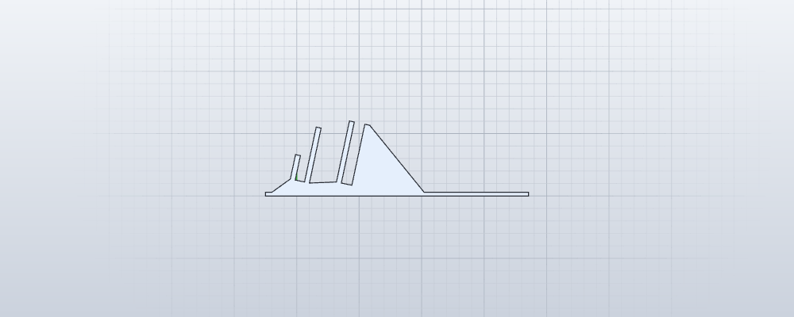

# interim_stand_shoe

Interim stand shoe: a 2D profile (XY) extruded 30 mm in Z. Both slots lean back 12°.
The profile is plain coordinates, not parametric. The model is not tied to `x1case.scad`.

| File | What |
|---|---|
| `stand_shoe_v1.stl` | original shoe |
| `stand_shoe_v2.stl` | reworked shoe |
| `solidcraft_v2.json` | SolidCraft batch that rebuilds v2 (`batch` with `path`) |
| `profile_v2.png` | profile view of v2 |

## v1 -> v2

- Rear (board) slot moved back 25 mm, measured square to the lean (25 / cos 12° = 25.56 mm in X), for air between monitor and board. The front wall is now separate, which leaves a 21 mm open channel.
- Board slot walls raised to 50 mm (were 40 mm back wall, 45 mm front wall).
- Brace keeps its 51° angle, so its foot moves to x = 102. The base runs from -25 to 185.6 mm.

v2 volume is 97 571 mm³, bbox 210.6 x 60.1 x 30 mm.
